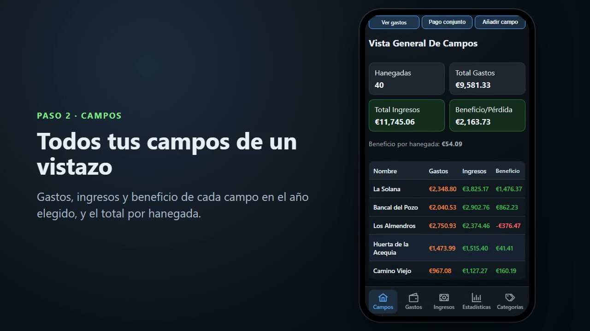
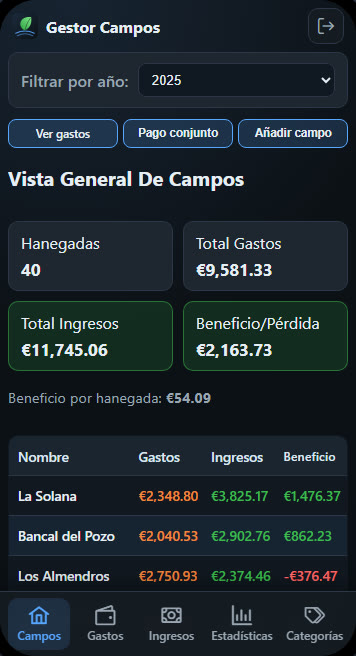
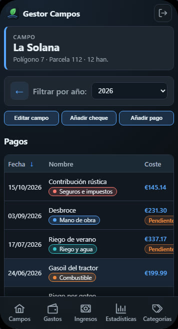
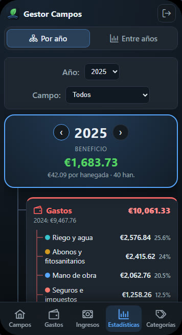
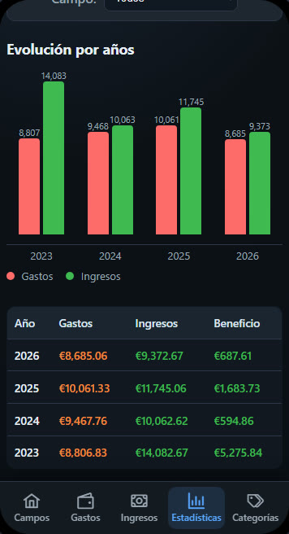

<p align="center">
  
</p>

<h1 align="center">Gestor Campos</h1>

<p align="center">
  <strong>Lo que pagas y lo que cobras de cada campo agrícola, año a año.</strong><br />
  Angular + Supabase, sin backend propio. App Android (Capacitor) y escritorio (Electron).
</p>

<p align="center">
  <a href="https://quiquealonso.github.io/gestor-campos/"><strong>Documentación y vídeo</strong></a> ·
  <a href="https://quiquealonso.github.io/gestor-campos/demo/"><strong>Demo</strong></a> ·
  <a href="docs/media/gestor-campos-demo.mp4">Vídeo (MP4)</a> ·
  <a href="#puesta-en-marcha">Puesta en marcha</a>
</p>

<p align="center">
  <a href="https://quiquealonso.github.io/gestor-campos/#video">
    
  </a>
</p>

<p align="center">
  
  
  
  
</p>

> Los datos del vídeo, las capturas y la demo son **ficticios**.

## Qué hace

- **Campos**: superficie (hanegadas), polígono y parcela. Gastos, ingresos y beneficio de cada uno en
  el año elegido, y el beneficio por hanegada.
- **Pagos**: fecha, importe, categoría y descripción opcional. Un pago puede contar para una campaña
  distinta del año de su fecha. La casilla **«Pagado del todo»** marca lo que aún se debe.
- **Pago conjunto**: un gasto común se reparte entre todos los campos según su tamaño, cuadrando al
  céntimo (método del resto mayor).
- **Ingresos**: los cheques de la cosecha, cada uno en su campo.
- **Gastos**: todos los pagos del año con filtros por categoría y estado (pendientes / pagados).
- **Estadísticas**:
  - *Por año*: un «mapa mental» con el beneficio en el centro y ramas de gastos por categoría,
    ingresos por campo, beneficio de cada campo y pagos pendientes.
  - *Entre años*: gastos, ingresos y beneficio de cada campaña, comparados.
- **Categorías**: con color. Al borrar una se elige qué pasa con sus pagos (sin categoría, moverlos o
  borrarlos).

## Cómo está hecha

| Parte | Tecnología | Carpeta |
| --- | --- | --- |
| Front | Angular 20 (standalone, signals), PrimeNG, CSS propio adaptado a móvil | `front/` |
| Datos | Supabase: PostgreSQL + Auth + API, vía `supabase-js` | `supabase/` |
| Móvil | Capacitor (APK Android) sobre el mismo front | `front/android/` |
| Escritorio | Electron (portable Windows) | `front/` |
| Demo y vídeo | Modo demo con datos ficticios + grabación automática con Playwright | `front/src/app/services/demo/`, `video/` |
| Web | GitHub Pages (presentación + demo) | `docs/` |
| Antiguo backend | Express + TypeORM, solo para scripts de migración desde PostgreSQL local | `back/` |

**Sin backend propio**: lo que tiene que ser seguro vive en la base de datos (`supabase/schema.sql`).
- **RLS** en todas las tablas: solo los emails de la tabla `propietario` leen o escriben; el rol
  anónimo no tiene acceso y el registro está desactivado.
- **Funciones SQL**: `pago_conjunto` y `eliminar_categoria`, en una sola transacción.
- **Validación** con restricciones `CHECK` (importes, fechas, años, colores), además de la de los
  formularios.

## Puesta en marcha

1. Crea un proyecto en [Supabase](https://supabase.com). En *Authentication*: desactiva
   *Allow new users to sign up* y crea tu usuario (*Add user*, con *Auto Confirm*).
2. En el *SQL Editor*, ejecuta `supabase/schema.sql` (se puede repetir) y autoriza tu email una vez:
   ```sql
   insert into public.propietario (email) values ('tu-email@ejemplo.com');
   ```
3. Configura el front. `environment.ts` es solo la plantilla; la configuración real va en
   `environment.local.ts`, que está ignorado por git:
   ```bash
   cp front/src/enviroments/environment.ts front/src/enviroments/environment.local.ts
   ```
   Rellena `supabaseUrl` y `supabaseAnonKey` (la clave *publishable*, que es pública por diseño).
   **Nunca** pongas ahí la clave *secret* / *service_role* ni la contraseña de la base de datos.
4. Arranca:
   ```bash
   cd front
   npm install
   npm start        # http://localhost:4200 (con tu Supabase)
   npm run demo     # http://localhost:4300 (modo demo, datos ficticios, sin Supabase)
   npm test         # tests unitarios (Karma)
   ```

### Móvil y escritorio

- **APK Android** (necesita Android Studio y su SDK): `npm run apk` en `front/` deja
  `GestorCampos.apk` en la raíz. Guía completa en [MOVIL.md](MOVIL.md).
- **Escritorio (Windows)**: `npm run electron-build` en `front/` genera un `.exe` portable en
  `front/dist-electron/`.

### Demo y vídeo

- `npm run build:demo` (en `front/`) genera la demo en `docs/demo/`, la que publica GitHub Pages.
- El vídeo se graba solo con Playwright sobre esa demo: ver [video/README.md](video/README.md).

### Datos desde un PostgreSQL local (opcional)

Si tenías los datos en un PostgreSQL local (el backend antiguo de `back/`), puedes copiarlos a
Supabase con `npm run migrate:local-to-supabase -- --dry-run` y luego `-- --replace`. Antes, crea
`back/.env.local` y `back/.env.supabase` a partir de `back/.env.example` (están ignorados por git).
